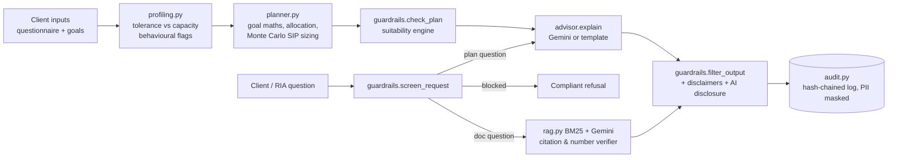

# RIA Co-pilot — compliant AI assistant for SEBI-registered Investment Advisers

**PS4 · Zetheta Algorithms × IIT Patna TIC Hackathon**

> 🎥 **Demo video (≤3 min, downloadable):** `<PASTE PUBLIC DOWNLOADABLE LINK HERE>`
> 📄 **Report:** `<link to report PDF>` · Team: `<names>` · Original GitHub ID / email for mapping: `<id / email>`

An AI co-pilot that (1) profiles a client's risk tolerance **and** capacity, (2) builds goal-based mutual fund
portfolios with SIP sizing and success probabilities, (3) answers SID / KIM / factsheet questions with
**page-level citations**, and (4) enforces SEBI suitability and conduct rules at every step.

**Design principle — the LLM never decides.** Risk profile, allocation, SIP, suitability and refusals are
computed by deterministic, unit-tested Python. The LLM (Gemini) only drafts explanations and reads documents,
and everything it writes passes a compliance filter. With no API key the app still works end-to-end
(template explanations + extractive document answers), so the demo cannot fail on a rate limit.

---

## Quick start

**Easiest:** Windows — double-click `setup_and_run.bat`. Mac — `bash setup_and_run.command`. It creates the environment, installs packages, runs the tests and opens the app.

Manual steps:

```bash
git clone <repo> && cd ria-copilot
python -m venv .venv && source .venv/bin/activate      # Windows: .venv\Scripts\activate
pip install -r requirements.txt
cp .env.example .env                                   # add GEMINI_API_KEY (free from Google AI Studio) - optional
python scripts/make_test_fixture.py                    # synthetic SID used by tests
pytest -q                                              # 46 tests
python scripts/run_personas.py                         # writes outputs/persona_matrix.md
streamlit run app.py
```

For the live demo, put real scheme documents (SID / KIM / monthly factsheet PDFs downloaded from AMC
websites or SEBI's mutual fund filings page) into `data/docs/`, or upload them in tab ③.

## Architecture



| Module | What it does |
|---|---|
| `copilot/profiling.py` | Reg. 16 inputs → tolerance score (4 psychometric factors) and capacity score (7 financial factors). Profile = `min(tolerance, capacity)`. Flags: tolerance > capacity, capacity > tolerance, F&O loss history (caps profile at Moderate), emergency-fund gap, no term / health cover, EMI burden. |
| `copilot/planner.py` | Inflation-adjusted targets; growth-asset share = `min(profile ceiling, horizon ceiling)`; mapping to SEBI MF categories (Direct plans); glide path; SIP sized by Monte Carlo (3,000 paths, seed 42) for a chosen success probability (default 70%); retirement-income three-bucket design with sustainable and 85%-confidence withdrawal. |
| `copilot/guardrails.py` | Request screen (9 rule families), allocation suitability check (equity vs profile, equity vs horizon, weighted riskometer, category eligibility, loss tolerance, concentration), output filter (no guaranteed / risk-free claims; mandatory disclaimer + AI disclosure), PII masking. |
| `copilot/rag.py` | Per-page PDF chunking, BM25 retrieval with finance synonyms, Gemini answers in JSON with source ids, **verifier** drops any sentence whose citation was not retrieved or whose numbers do not appear on the cited page; extractive fallback. |
| `copilot/audit.py` | Append-only JSONL with SHA-256 hash chain (tamper-evident), PII masked. |
| `app.py` | Streamlit: ① Profile ② Goal plan (+ live adviser override re-check) ③ Ask (SID / plan chat) ④ Compliance (test-bench, audit log). |

## Persona results (`python scripts/run_personas.py`)

| Persona | Profile (tol / cap) | Key outcome |
|---|---|---|
| Fresh Graduate, 23 | Moderate (2.62 / 4.58) | Emergency fund first (₹13.3k/mo for 12 months in overnight + liquid), then ₹10.8k/mo SIP (+10%/yr) for long-term wealth, 55% growth assets |
| Young Couple, 31 | Moderately Aggressive (3.67 / 3.98) | Child education: ₹25L today → ₹1.04 Cr in 15 yrs at 10% education inflation; ₹16k/mo SIP, 71% success; emergency top-up flagged |
| Small Business, 44 | Moderate (3.52 / 3.30) | 12-month business-cycle buffer; retirement at 58 needs ₹60.8k/mo; **flag: total SIPs exceed surplus** and **no term cover** |
| Doctor (Patna), 38 | Moderately Conservative (1.80 / 4.08) | Capacity is high but tolerance governs (35% growth cap); healthcare corpus capped at 40% growth regardless of profile |
| Retiree (Chennai), 68 | Moderately Conservative (1.80 / 2.67) | ₹80L in 3 buckets; ₹40k/mo inflation-linked has only ~7% chance of lasting 25 yrs; sustainable ≈ ₹34.4k, 85%-safe ≈ ₹30.3k |
| Aggressive Trader, 29 | Capped at Moderate (4.92 / 4.42) | **Block flag**: 60% F&O loss → derivatives advice refused (cites SEBI FY25 study), no mid/small caps, emergency fund first |

Guardrail probes: **13/13 pass** (guaranteed-return asks, F&O, profile override, stock tips, crypto, plus allowed questions).

## Regulatory mapping

| Requirement | Where enforced |
|---|---|
| SEBI (IA) Regulations 2013, Reg. 16 — risk profiling incl. capacity for loss | `profiling.py`; Reg. 16 checklist + client consent gate in tab ① |
| Reg. 17 — suitability of advice | `guardrails.check_allocation` on every plan and every adviser override |
| IA Guidelines (8 Jan 2025) — disclose extent of AI use; adviser solely responsible; data confidentiality | AI disclosure appended to every output; AI-usage acknowledgement gate; PII masking before LLM; LLM never decides |
| Record keeping (Reg. 19) / AI traceability | Hash-chained audit log of every plan, answer and refusal |
| Riskometer (SEBI, Oct 2020; six levels) | Category riskometer → weighted portfolio score vs profile ceiling |
| Advice vs distribution segregation | Direct plans only; regular-plan / commission requests answered with that rule |
| MF advertising norms | Standard disclaimer; output filter removes guaranteed / risk-free / sure-shot language |

## Reproducibility

* Data cut-off: `config.DATA_CUTOFF` (last trading day before the event). `scripts/fetch_nav.py` discards any NAV after it.
* All simulations use seed 42; `pytest -q` and `scripts/run_personas.py` reproduce every number in the report.
* Category return / volatility figures in `config.py` are planning assumptions; `scripts/fetch_nav.py`
  recomputes 5-year category medians from AMFI data into `data/category_stats.csv` for comparison.
  *(This script needs internet access to amfiindia.com and api.mfapi.in.)*

## Assumptions & data sources

* SEBI (Investment Advisers) Regulations, 2013 and Second Amendment Regulations, 2024 — sebi.gov.in
* SEBI Guidelines for Investment Advisers, 8 Jan 2025 (AI-tool disclosure and responsibility) — sebi.gov.in
* SEBI circular on product labelling / riskometer, Oct 2020 (six levels from 1 Jan 2021) — sebi.gov.in
* SEBI circular on categorisation and rationalisation of MF schemes, Oct 2017 — sebi.gov.in
* SEBI study on individual traders' P&L in equity F&O, FY25 (published July 2025; ~91% made losses) — sebi.gov.in
* AMFI NAV data — amfiindia.com/spages/NAVAll.txt ; scheme NAV history — api.mfapi.in
* Inflation: general 6% (upper end of RBI's 4% ± 2% target band), education 10%, healthcare 11% — planning assumptions, editable
* Scheme documents used in the demo: `<list each SID/KIM/factsheet with AMC, month and URL>`

## AI tool disclosure (rulebook requirement)

| Tool | Use |
|---|---|
| Google Gemini API (`gemini-3.6-flash`, fallback `gemini-2.5-flash`) | Runtime: drafts plan explanations; answers document questions in JSON with source ids (then verified) |
| Anthropic Claude | Development: code scaffolding, test writing, report drafting — all reviewed and edited by the team |
| `<add any other tool>` | `<use>` |

## Limitations

Category-level (not scheme-level) return assumptions; normal/lognormal returns understate tail risk; taxation
is not modelled in SIP sizing; regex request screen can be bypassed by novel phrasing (mitigated by the
output filter and deterministic plan engine); not legal advice — a registered adviser must review every output.

## Submission checklist

- [ ] Repo public, ownership transferred to **ZethetaIntern**; original user ID + email sent to Zetheta
- [ ] Demo video link (public, downloadable) at top of this README and on page 1 of the report
- [ ] Report PDF ≤ 8 pages with selectable text, < 20 MB
- [ ] Bibliography + AI tool declaration complete
