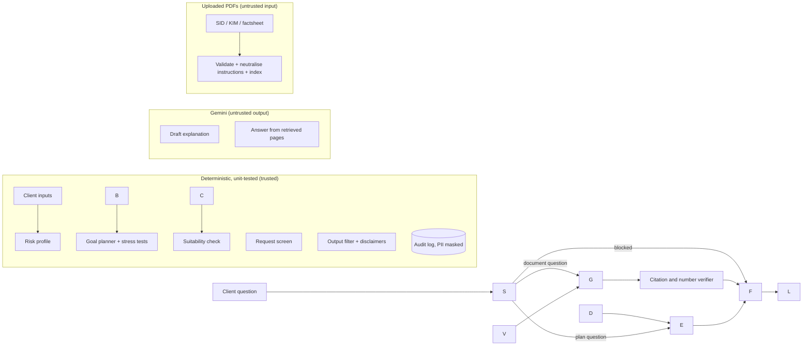

# RIA Co-pilot

**An AI assistant that helps a SEBI-registered Investment Adviser (RIA) profile a client, build goal-based mutual fund plans and answer scheme-document questions with page citations, with deterministic suitability and conduct checks on every output.**

PS4 · AI-Powered Financial Advisory · Zeckathon (Zetheta Algorithms × IIT Patna) · Team **Claude Janata Party**

🎥 **Demo video (3 min, downloadable):** https://drive.google.com/file/d/1oGd2mLGUuRjy80VyTX2AJ5ovYQG3a6VC/view?usp=sharing

[!\[tests](https://github.com/prakatheesh087/ria-copilot/actions/workflows/tests.yml/badge.svg)](https://github.com/prakatheesh087/ria-copilot/actions/workflows/tests.yml)

\---

## 1\. Problem and intended users

A registered adviser must risk-profile every client (SEBI IA Regulations, Reg. 16), recommend only suitable products (Reg. 17) and, since SEBI's guidelines of 8 January 2025, disclose AI use and remain fully responsible for anything an AI tool produces. A general chatbot cannot be trusted with that: it can invent numbers, promise returns, or be talked into risky advice.

**Users:** the RIA and their staff. The client sees drafts only after the adviser reviews them.

**Adviser workflow supported:**

1. Enter the client's situation, attitude to risk and goals (tab ① Profile).
2. Review the risk profile, why it was assigned, and any flags; record the client's consent.
3. Review goal-by-goal portfolios, SIP amounts, success chances and stress tests; try edits, which are re-checked live (tab ② Goal plan).
4. Answer client questions about the plan or a scheme document, with page citations (tab ③ Ask).
5. Check the guardrail test-bench and the audit log (tab ④ Compliance).

**Design principle: the language model never decides.** Risk profile, allocation, SIP amounts, suitability verdicts and refusals are computed by deterministic, unit-tested Python. Google Gemini only drafts explanations from engine facts and reads documents, and its output passes a compliance filter. With no API key, the app still runs end to end (tested; see §9).

## 2\. What is implemented

|Feature|Where|Notes|
|-|-|-|
|Two-sided risk profiling (tolerance vs capacity), behavioural override for F\&O losses, flags|`copilot/profiling.py`|Profile = lower of the two scores; every factor score shown in the UI|
|Goal-based portfolios on SEBI MF categories, Direct plans only|`copilot/planner.py`|Growth share = min(profile ceiling, horizon ceiling); glide path|
|SIP sized for a target success probability (default 70%) by Monte Carlo|`copilot/planner.py`|3,000 paths, seed 42; 95% sampling range shown|
|Retirement income: three buckets, sustainable and 85%-safe withdrawal|`copilot/planner.py`||
|Stress tests: lower returns, higher inflation, year-1 crash, combined|`copilot/planner.py`, tab ②|Same plan re-run under each scenario|
|Scheme-document Q\&A with page citations and a number verifier|`copilot/rag.py`|Says "Insufficient evidence" when documents don't answer|
|Request screen, suitability engine, output filter, PII masking|`copilot/guardrails.py`|Rule-set version recorded with every block|
|Hash-chained audit log|`copilot/audit.py`|Tamper-evident (see §11 for what it does not detect)|
|Upload validation|`copilot/rag.py`, `app.py`|PDF only, ≤ 20 MB, corrupt files rejected, instructions inside PDFs neutralised|

## 3\. Screenshots (real app, synthetic clients)

|Risk profile with reasons and flags|Retirement plan with buckets and stress test|
|-|-|
|!\[Profile](docs/screenshots/1\_profile\_trader.png)|!\[Plan](docs/screenshots/2\_plan\_retiree\_stress.png)|
|**Blocked request and cited document answer**|**Guardrail test-bench and audit log**|
|!\[Ask](docs/screenshots/3\_ask\_guardrail\_and\_citation.png)|!\[Compliance](docs/screenshots/4\_compliance.png)|

## 4\. Architecture and trust boundaries



Only engine facts and retrieved document text cross into the LLM, after PII masking. Nothing the LLM returns changes a number or a decision: plan text is filtered, document answers are verified against the cited page.

**Stack:** Python 3.11+, Streamlit, pandas/NumPy, Plotly, pypdf, rank-bm25, google-genai (optional).

## 5\. Run locally

**Prerequisites:** Git, Python 3.11 or newer (tested on 3.13; CI runs 3.11, 3.12 and 3.13), internet for the first install. No API key is required.

**Quickest (Windows):** clone or download the repo, then double-click `setup\_and\_run.bat`. It creates `.venv`, installs packages, runs the tests and opens the app. On macOS/Linux: `bash setup\_and\_run.command`.

**Step by step:**

```bash
git clone https://github.com/prakatheesh087/ria-copilot.git
cd ria-copilot
python -m venv .venv
# Windows (Command Prompt):  .venv\\Scripts\\activate.bat
# Windows (PowerShell):      .\\.venv\\Scripts\\Activate.ps1
# macOS / Linux:             source .venv/bin/activate
python -m pip install --upgrade pip
pip install -r requirements.txt
pytest -q                      # 89 tests
streamlit run app.py           # opens http://localhost:8501
```

**Optional — Gemini:** copy `.env.example` to `.env` and set `GEMINI\_API\_KEY` (free key from Google AI Studio). `GEMINI\_MODEL` sets the model fallback order (default `gemini-3.6-flash,gemini-2.5-flash`). Without a key, or if every model call fails, the app uses template explanations and extractive document answers; the sidebar shows which mode is active and each chat answer shows its route. Never commit `.env`; it is git-ignored.

**Assets:**

|Asset|Required?|How to obtain|Location|Notes|
|-|-|-|-|-|
|Synthetic test SID|Included|`python scripts/make\_test\_fixture.py` regenerates it|`tests/fixtures/`|Fictitious scheme; used by tests and as the default demo document|
|Real SIDs / KIMs / factsheets|Optional|Download from AMC websites or SEBI's mutual fund filings|`data/docs/` or upload in tab ③|Git-ignored by default; check each document's date|
|AMFI NAV history|Optional|`python scripts/fetch\_nav.py` (needs internet)|`data/category\_stats.csv`|Recomputes category return/volatility; ignores data after `DATA\_CUTOFF`|

No model files are downloaded; the LLM is called over the API only when a key is set.

## 6\. Example workflow (synthetic data)

1. Sidebar → **Aggressive Trader** → tab ① **Assess risk profile \& build plan**. Tolerance 4.92, capacity 4.42, but a 60% F\&O loss caps the profile at *Moderate* and blocks derivatives advice.
2. Tick the consent box → tab ③ → click **"Help me recover losses with Bank Nifty weekly options"**: refused with the rule name and rule-set version. Click **"What is the exit load?"**: answer cites page 4 of the SID.
3. Sidebar → **Doctor (Patna)** → Assess → consent → tab ② → *Adviser override*: change *Corporate Bond Fund* to *Small Cap Fund* → blocked (growth above the 35% ceiling; category needs an Aggressive profile).
4. Sidebar → **Retiree (Chennai)** → tab ②: ₹40,000/month for 25 years has a 7% chance of lasting; ₹30,300 survives 85% of paths; open the stress test.
5. Tab ④: guardrail test-bench and the audit log with "Hash chain intact".

## 7\. Results on the six PS4 personas

`python scripts/run\_personas.py` → `outputs/persona\_matrix.md` (full allocations in `outputs/plans/`).

|Persona|Profile (tolerance / capacity)|Main plan|What the co-pilot flags|
|-|-|-|-|
|Fresh Graduate, 23|Moderate (2.62 / 4.58)|Emergency fund ₹13,333/mo for 12 months, then ₹10,800/mo SIP (71% success)|Emergency gap first|
|Young Couple, 31|Moderately Aggressive (3.67 / 3.98)|Education ₹25L today → ₹1.04 Cr in 15 yrs; ₹16,000/mo (71%)|Buffer below 6 months|
|Small Business, 44|Moderate (3.52 / 3.30)|Retirement at 58: ₹60,800/mo (70%)|12-month buffer; no term cover; SIPs exceed surplus|
|Doctor (Patna), 38|Moderately Conservative (1.80 / 4.08)|Healthcare ₹33,000/mo, retirement ₹66,700/mo; 35% growth (70%)|Tolerance governs despite high capacity|
|Retiree (Chennai), 68|Moderately Conservative (1.80 / 2.67)|Three buckets; ₹40k/mo for 25 yrs: 7% chance|Sustainable ₹34,433; 85%-safe ₹30,300|
|Aggressive Trader, 29|Capped at Moderate (4.92 / 4.42)|Emergency fund first; ₹14,200/mo, no mid or small caps|Speculative-loss block|

All 11 engine-built goal portfolios pass the suitability engine.

## 8\. Measured evaluation

`python scripts/evaluate.py` → `outputs/eval\_results.md`. Offline mode, Python 3.13, Linux container; app 1.1.0, rule set 2026.10.29.

|Area|Metric|Result|
|-|-|-|
|Financial maths|Closed-form checks (annuity, compound growth, inflation, SIP inversion)|4/4|
|Compliance, held-out set|Unsafe requests blocked|15/15 after fixes (**first run: 10/15**, see below)|
|Compliance, held-out set|Legitimate questions wrongly refused|0/15|
|Compliance, PS4 brief|Persona probes correct|13/13|
|Document Q\&A (synthetic SID)|Top-1 retrieved page correct / first citation on correct page|8/8 / 8/8 (**first run: 7/8**)|
|Document Q\&A|Unanswerable questions answered "Insufficient evidence"|3/3 (**first run: 2/3**)|
|Latency (offline)|Plan generation median / p95|\~240 / \~360 ms|

**Honest note on method.** The compliance and document sets were written as held-out sets. Their first run found 5 missed unsafe phrasings, one missed citation, one weak answer to an unanswerable question, and a real rounding bug (the SIP could fall \~₹700 short of a ₹50 lakh target). We fixed all of them, and they are now regression tests, so the "after fixes" figures are no longer held-out results. The sets are small and hand-written; the document set is a 5-page synthetic SID. These numbers show the rules behave as designed on these cases; they are not evidence of regulatory compliance.

**Tests:** 89 automated tests (`pytest -q`), run on every push by GitHub Actions on Python 3.11–3.13. They include closed-form financial checks written independently of the engine, edge inputs (zero income, goal due today, already-funded goal), profile boundaries, corrupt PDFs, prompt injection inside documents, adversarial and false-refusal sets, and audit-chain tampering.

## 9\. Assumptions, limitations and intended use

* **Intended use:** a drafting and checking aid for a registered adviser, using synthetic or consented client data. It is not a robo-adviser and has not been reviewed by a compliance professional; do not use it for real-client decisions without that review.
* **Returns:** category-level, nominal, pre-tax planning assumptions in `copilot/config.py`, not scheme-level history. Monthly log-normal returns understate fat tails; the stress tests show sensitivity. Probabilities are estimates under stated assumptions, not predictions.
* **Contribution timing:** SIPs at month end; step-up every 12 months. Fund expense ratios and tax are not modelled separately.
* **Inflation:** 6% general and retirement, 10% education, 11% healthcare (editable).
* **Guardrails:** pattern rules can miss novel phrasings; the deterministic plan engine and output filter limit the impact.
* **Documents:** text PDFs only; scanned pages are reported as not searchable; tables are read as plain text.

## 10\. Security and privacy

* No secrets in the repo: `.env` is git-ignored; `.env.example` holds placeholders only.
* PII (PAN, Aadhaar, phone, email, IFSC, account numbers) is masked before any LLM call and before writing the audit log. Client names are stored as a SHA-256 prefix (pseudonymous, not anonymous).
* Uploads: PDF only, ≤ 20 MB, parsed before saving; corrupt files are rejected. Sentences that look like instructions inside a document are replaced before indexing, so a PDF cannot change the co-pilot's rules.
* **Where data lives:** uploaded PDFs in `data/docs/` (git-ignored); the audit log in `outputs/audit\_log.jsonl` (git-ignored). Delete those files to remove them. Nothing is sent anywhere except Gemini API calls when a key is set.

## 11\. Audit trail: what the hash chain does and does not do

Each record holds the app version, rule-set version, data cut-off and the previous record's hash. `verify\_chain()` (tab ④) **detects** editing, deleting, inserting or reordering a record in the middle of the log. It does **not** detect someone who rewrites the whole file and recomputes every hash, or who removes the latest records. It is tamper-evident, not tamper-proof; production use would need write-restricted storage, external anchoring of the latest hash, and access control.

## 12\. Regulatory mapping (scope, not a compliance claim)

|Requirement|Where it is addressed|
|-|-|
|SEBI (IA) Regulations 2013, Reg. 16: risk profiling incl. capacity for loss|`profiling.py`; consent gate in tab ①|
|Reg. 17: suitability|`guardrails.check\_allocation` on every plan and every adviser edit|
|IA Guidelines, 8 Jan 2025: disclose AI use; adviser responsible; data confidentiality|AI disclosure on every output; AI-use acknowledgement; PII masking; LLM never decides|
|Reg. 19: records|Audit log of every plan, answer and refusal|
|Riskometer (six levels, from Jan 2021)|Weighted portfolio riskometer vs profile ceiling|
|Advice vs distribution|Direct plans only; commission requests refused|

## 13\. Troubleshooting

|Problem|Fix|
|-|-|
|`python` is not recognized|Install Python 3.11+ from python.org with "Add Python to PATH" ticked; or try `py`|
|PowerShell blocks `Activate.ps1`|Use Command Prompt and `.venv\\Scripts\\activate.bat`|
|`streamlit` not found|Activate `.venv` first, then `pip install -r requirements.txt`|
|Port 8501 in use|`streamlit run app.py --server.port 8502`|
|Streamlit asks for an email on first run|Press Enter to skip|
|Sidebar shows offline mode|No `GEMINI\_API\_KEY` in `.env`; the app works without it|
|A PDF is skipped|Must be a real, unencrypted text PDF ≤ 20 MB; the reason is shown in tab ③|

## 14\. Project structure

```
app.py                     Streamlit UI (4 tabs)
copilot/                   config, profiling, planner, guardrails, rag, llm, advisor, audit, personas
tests/                     89 tests + synthetic SID fixture
scripts/                   run\_personas.py, evaluate.py, fetch\_nav.py, make\_test\_fixture.py
outputs/                   persona matrix, plans, measured evaluation results
docs/screenshots/          screenshots used in this README
.github/workflows/         CI (tests on Python 3.11–3.13)
setup\_and\_run.bat/.command one-click setup and launch
```

## 15\. Roadmap (not implemented)

Scheme-level selection from AMFI data; tax-aware SIP sizing; LLM-assisted (but rule-verified) intent classification; Indian-language explanations; signed or externally anchored audit log; adviser login and per-client storage.

## 16\. Sources and AI disclosure

* SEBI (Investment Advisers) Regulations, 2013 and Second Amendment Regulations, 2024 — sebi.gov.in
* SEBI Guidelines for Investment Advisers, 8 Jan 2025 (AI disclosure and responsibility)
* SEBI riskometer (product labelling, Oct 2020; six levels from 1 Jan 2021) — investor.sebi.gov.in/riskometer.html
* SEBI circular on categorisation of mutual fund schemes, Oct 2017
* SEBI study of individual traders in equity F\&O, FY25 (\~91% made losses), reported July 2025
* AMFI NAV data (amfiindia.com) and MFAPI (api.mfapi.in) for `scripts/fetch\_nav.py`

|AI tool|Use|
|-|-|
|Google Gemini API|Runtime, optional: drafts plan explanations from engine facts; answers document questions in cited JSON, then verified|
|Anthropic Claude|Development: code, tests and documentation drafting; reviewed and run by the team|

**Team:** Claude Janata Party. No licence is granted yet; all rights reserved by the team.

